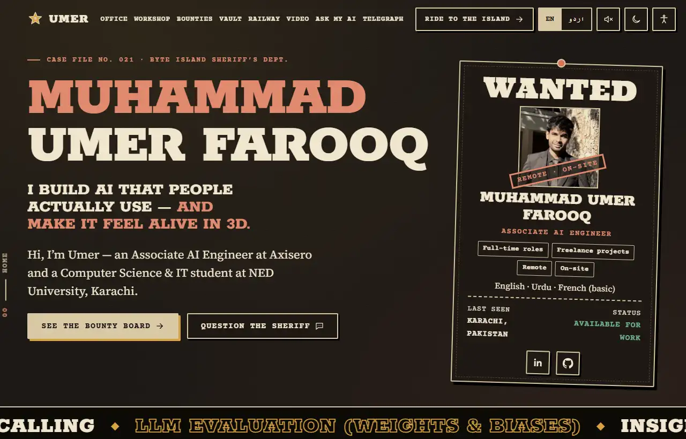
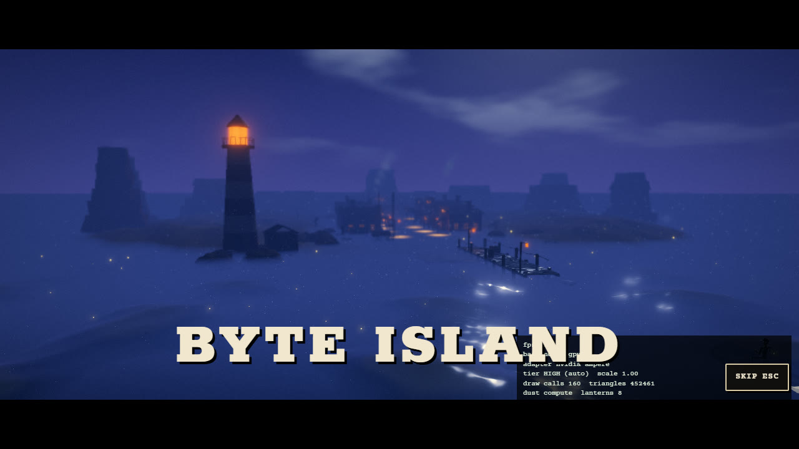
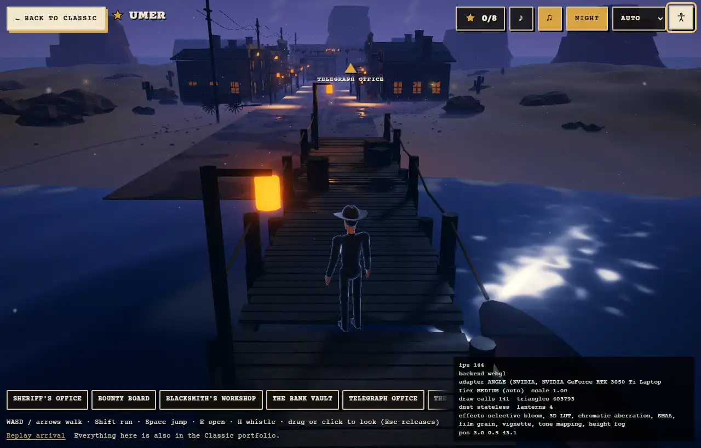
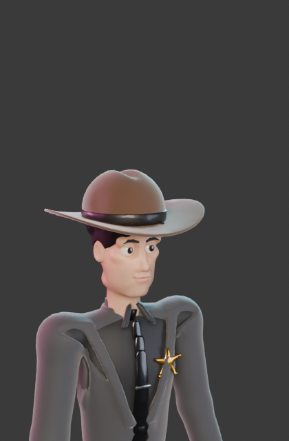
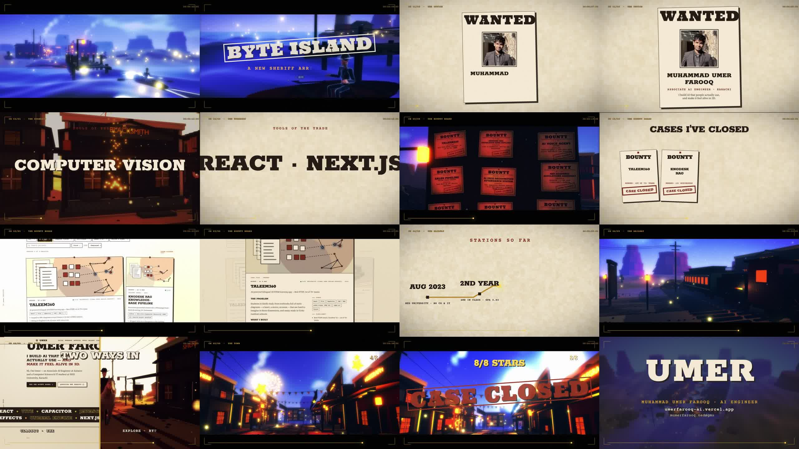
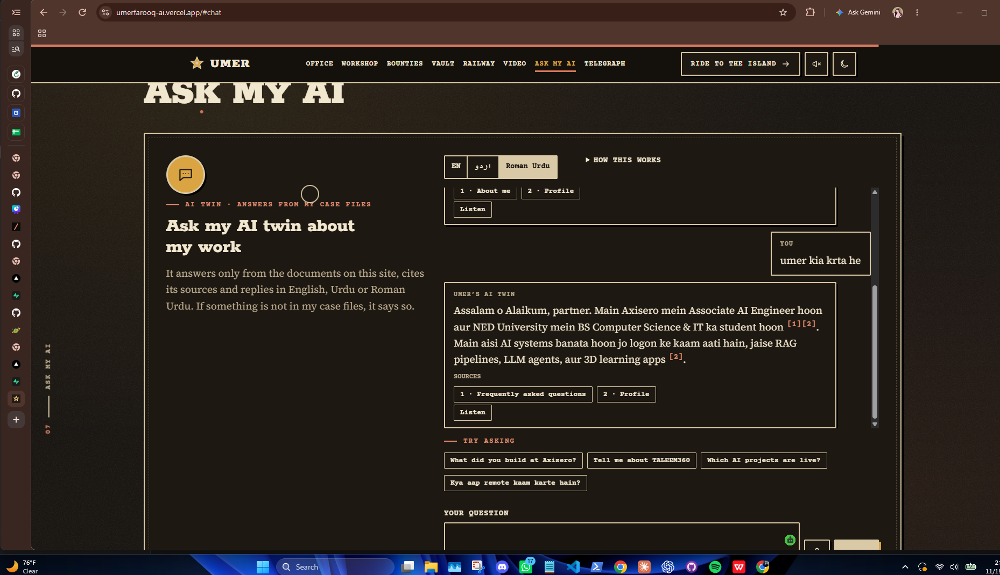
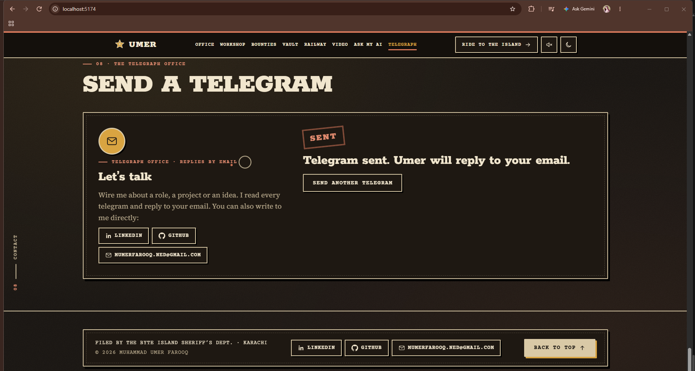
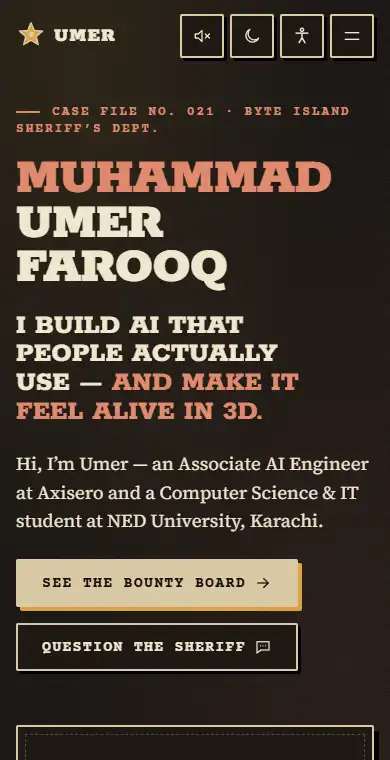
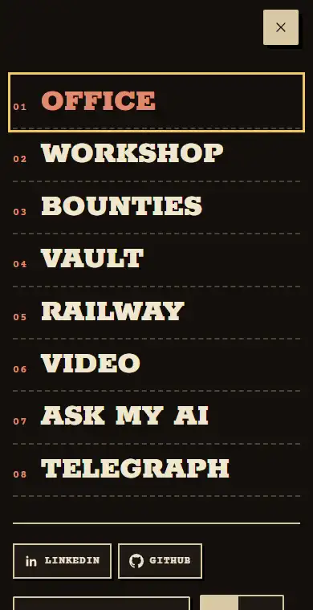
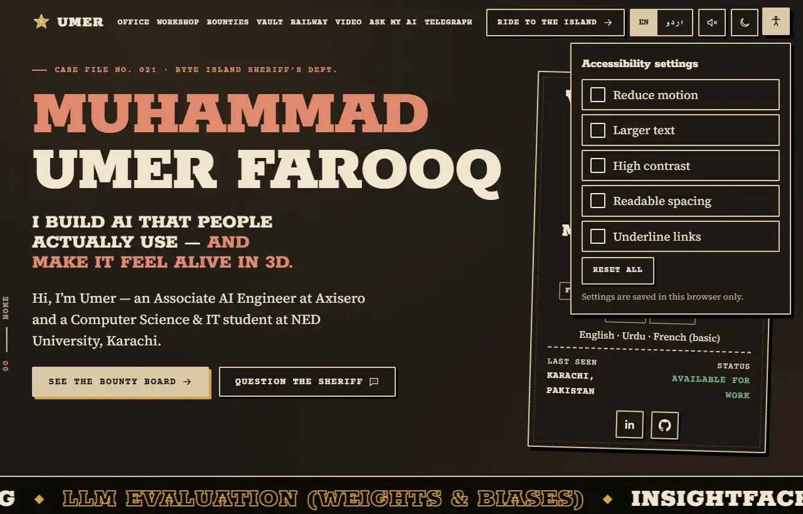

# Sheriff of Byte Island

**An interactive 3D web portfolio of Muhammad Umer Farooq, Associate AI Engineer.**

- **Live site:** https://umerfarooq-ai.vercel.app
- **Code:** https://github.com/muhammadumerfarooqq/web3d-portfolio
- **4K promo video (Release page):** https://github.com/muhammadumerfarooqq/web3d-portfolio/releases/tag/v1.0-submission (created at submission; steps in [docs/DOWNLOADS.md](docs/DOWNLOADS.md))
- **Google Drive folder (view only):** https://drive.google.com/drive/folders/185n2-ZxJU7ran22IJLQIOOG1C3t_3nVd?usp=drive_link
- **Student:** Muhammad Umer Farooq, BS CS&IT, NED University of Engineering and Technology (CTGA-021)
- **Course:** Web 3D Programming · **Teacher:** Saadia Arshad

---

## Submission

- **The GitHub repository is the complete submission.** The Google Drive folder and the Release page are convenience copies for large files.

| Item | In the GitHub repo | Also on Google Drive | Release |
|---|---|---|---|
| Source code (frontend + backend) | `src/`, `api/`, `scripts/`, `supabase/`, `content/` | repo only | – |
| Blender `.blend` + GLB | `blender/avatar.blend`, `blender/export/avatar.glb`, `public/models/avatar.glb` | `Avatar_Blender` | – |
| After Effects `.aep` + 1080p MP4 | `aftereffects/promo.aep`, `aftereffects/promo.jsx`, `public/media/promo-1080.mp4` | `Video_AfterEffects` | yes |
| 4K MP4 (244 MB) | not in git (GitHub's 100 MB file limit) | `Video_AfterEffects` | yes |
| Report PDF | `docs/report/` (added by 27 Nov 2026) | `Report` | yes (added by 27 Nov 2026) |
| Screenshots | `docs/screenshots/` | `Screenshots` | – |
| README | `README.md` (this file) | repo only | – |
| Live site | https://umerfarooq-ai.vercel.app | – | – |

**Links:** [live site](https://umerfarooq-ai.vercel.app) · [GitHub repository](https://github.com/muhammadumerfarooqq/web3d-portfolio) · [Release v1.0-submission](https://github.com/muhammadumerfarooqq/web3d-portfolio/releases/tag/v1.0-submission) · [Google Drive folder, view only](https://drive.google.com/drive/folders/185n2-ZxJU7ran22IJLQIOOG1C3t_3nVd?usp=drive_link)

## 1. What this project is

- **A story, not a template.** A sheriff arrives on Byte Island and files the cases he has closed. Every section of the portfolio is a part of that story.
- **Two ways to visit.** *Classic* is a normal scrolling page. *Explore* is a 3D island you walk around, with a Blender sheriff, a horse, a train and eight buildings.
- **Real content.** Profile, skills, projects ("bounties"), awards ("vault"), education and work ("railway"), a promo film and a contact form. All text lives in [content/](content/) and feeds both the page and the chatbot.
- **AI inside.** "Ask my AI" answers questions about Umer from his own documents only, cites its sources, and works by typing or by voice in English, Urdu and Roman Urdu.
- **Built for real use.** Deployed on Vercel, data in Supabase, email delivery, spam protection, an owner-only admin page, privacy-friendly analytics.

## 2. Quick look

**Classic** (the page at `/`)
- Scroll through Home, Office, Workshop, Bounties, Vault, Railway, Video, Ask my AI and Telegraph.
- Filter and search projects, open a case, play the film with captions, chat, send a telegram, download the CV.
- Works on phones: menu drawer, 44 px touch targets, no sideways scroll from 320 px up.

**Explore** (button "Ride to the island")
- Walk the island (keyboard, mouse or touch), enter buildings to open the same content as case files.
- Collect 8 stars (one per building) and finish with the "Case Closed" ceremony and a certificate.
- Day and night, a quality setting (Auto, Low, Medium, High, Ultra), music, sound, a horse and a train.

**For everybody**
- **Language:** EN | اردو in the header (Urdu is right to left).
- **Themes:** dark and light; Explore follows the theme (night and golden hour).
- **Accessibility menu:** reduce motion, larger text, high contrast, readable spacing, underlined links, plus a "skip 3D" route.

## 3. Tech stack

| Layer | Tool | Why |
|---|---|---|
| Build | Vite 8 | fast, multi-page (site + admin) |
| Page | plain JavaScript, Tailwind 4, GSAP, Lenis | small, smooth scroll and reveals |
| 3D | three.js 0.187 (WebGPU, WebGL2 fallback), three-mesh-bvh | the island and collisions |
| Models | Blender 5.2 (Python scripts) → Draco GLB | original avatar and town |
| Video | After Effects → ffmpeg MP4 | the 45-second promo |
| API | Vercel Functions (Node, region `bom1`, 9 of 12 free) | contact, chat, voice, admin |
| Database | Supabase Postgres + pgvector + Auth | data, vector search, TOTP login |
| AI | Gemini embeddings, Groq LLM, Groq Whisper | search, answers, speech to text |
| Email | Gmail SMTP (nodemailer) | telegrams to Umer's inbox |
| Spam | Cloudflare Turnstile, honeypot, rate limits | keep bots out |
| Checks | zod, Vitest, Playwright (real Chrome), axe | same rules both sides, QA |

## 4. How to run it

**Prerequisites:** Windows PowerShell, Node.js 24 or newer (see `engines` in `package.json`), npm 11+, git.

```powershell
git clone https://github.com/muhammadumerfarooqq/web3d-portfolio.git
cd web3d-portfolio
npm ci
Copy-Item .env.example .env
```

Fill `.env` (names only here, never commit it). Only `VITE_` variables reach the browser.

| Variable | What it is | Where to get it |
|---|---|---|
| `SUPABASE_URL`, `VITE_SUPABASE_URL` | project address | Supabase → Project settings → API |
| `SUPABASE_SERVICE_ROLE_KEY` | full database access (server only) | same page, "service_role" |
| `VITE_SUPABASE_ANON_KEY` | public key for the admin login | same page, "anon" |
| `GEMINI_API_KEY` | embeddings | Google AI Studio |
| `GROQ_API_KEY` | chat model and Whisper | console.groq.com |
| `LLM_MODEL`, `LLM_FALLBACK_MODEL`, `LLM_SECONDARY_MODEL` | chat models, tried in order | Groq model list |
| `EMBED_MODEL`, `EMBED_DIM` | embedding model and size (768) | Google AI docs |
| `STT_MODEL` | speech to text (`whisper-large-v3`) | Groq model list |
| `RAG_MIN_SIMILARITY`, `CHAT_DAILY_CAP` | answer threshold, daily chat limit | you choose |
| `SMTP_USER`, `SMTP_APP_PASSWORD`, `CONTACT_TO` | Gmail sender, its App Password, inbox that receives | Google account → App passwords |
| `TURNSTILE_SECRET_KEY`, `VITE_TURNSTILE_SITE_KEY` | spam check keys | Cloudflare → Turnstile |
| `IP_HASH_SALT` | random salt for hashing visitor IPs | any long random string |
| `CRON_SECRET` | protects the daily keep-alive call | any long random string |

**Supabase setup** (SQL editor, run each file once, in this order; all are safe to re-run):

| File | Purpose |
|---|---|
| `0001_contact_messages.sql` | contact messages (locked down) |
| `0002_rag.sql` | enables pgvector, chatbot tables, hybrid search |
| `0003_voice.sql` | rate limit for voice |
| `0004_hardening.sql` | closes a helper function to the public key |
| `0005_admin.sql` | admin user table, project order, login limits |
| `0006_analytics.sql` | anonymous daily counters |
| `0007_admin_fixes.sql` | fixes "Save order" (`pg_safeupdate`) |

Then: Authentication → Users → add the admin user (auto-confirm) → keep **sign-ups off** → Multi-Factor: enable **TOTP** (enrol and verify) → insert that user into `public.admins` (SQL at the end of `0005_admin.sql`). Run `npm run rls:verify` (every line PASS).

```powershell
npm run rag:ingest        # builds the chatbot's knowledge base (reads .env, prints counts only)
npm run rag:verify        # every line should say PASS
npm run dev               # http://localhost:5173 (the /api routes run locally too)
npm run build             # run this from PowerShell, not Git Bash
npm run preview           # http://localhost:4173, the production build
```

**Checks**

```powershell
npm test                  # all tests (Vitest)
npm run test:security     # the security tests with one summary
node scripts/csp-check.mjs      # real Chrome, zero CSP violations expected (build first)
npm run qa:responsive     # 320 to 1280 px, English and Urdu (build first)
npm run live:check        # black-box checks of the live site's headers and API
```

**Deploy to Vercel:** import the GitHub repo, add every variable above to Production and Preview, deploy. `vercel.json` already sets region `bom1`, the security headers and the daily cron `/api/cron/keepalive`. In Cloudflare, add the site's domain and `localhost` to the Turnstile hostnames.

**Troubleshooting (all happened during the build)**
1. **Admin API answers 404 on Vercel:** nested paths never reach the catch-all function. The routes are single segments (`/api/admin/mfa-enroll`, `/api/admin/mfa-verify`).
2. **"Could not start the two-step setup":** Supabase → Authentication → Multi-Factor must have TOTP enrol **and** verify switched on (log line `mfa_totp_enroll_not_enabled`).
3. **Admin login says to wait:** limit is 5 logins and 10 codes per 10 minutes; wait, then log in once.
4. **"Save order" fails with code 21000:** run `0007_admin_fixes.sql` (Supabase refuses a DELETE without WHERE).
5. **Built page has no social links or CV button:** the build was run from Git Bash (content markers stay unreplaced). Build from PowerShell.

## 5. How to use it

**Classic**
- **Menu:** header links on desktop, hamburger drawer on phones (Esc closes it).
- **Projects:** category chips, tech filter, search box, sort (featured, newest, A to Z), "Open case" for details.
- **Chat:** pick EN, اردو or Roman Urdu, type or press the microphone, use "Listen" to hear the answer.
- **Contact:** name, email, subject, message; success and error messages appear under the form.
- **CV:** "Download CV" on the profile card. **Language:** EN | اردو. **Theme:** moon/sun button. **Accessibility:** person icon in the header.

**Explore**

| Action | Control |
|---|---|
| Walk | W A S D or arrow keys; touch: left stick |
| Run / jump | Shift / Space; touch: Run and Jump buttons |
| Open a building, mount or dismount the horse | E or Enter; touch: Open button |
| Whistle for the horse | H; touch: Whistle button |
| Look around | drag the mouse, or click the view for mouse look (Esc releases it); touch: drag |
| Zoom | mouse wheel |
| Ride | W / S faster / slower, A / D turn, E dismount |
| Fast travel | building chips at the bottom (desktop) |
| Stars and case board | star counter, top right |
| Sound, music, day/night, quality | top-right buttons and the quality menu |
| Leave | "Back to Classic" (top left) or "Open plain Classic site (skip 3D)" in the accessibility menu |

- **Hotspots:** 8 buildings (Sheriff's Office, Bounty Board, Blacksmith's Workshop, Bank Vault, Telegraph Office, Picture House, Byte Island Station, Saloon). Walk to a door to open its case file; each gives one star. 8 of 8 closes the case.
- **Phones:** Explore has touch controls, but the HUD is dense; Classic is the comfortable choice. Explore is not offered with reduced motion or Data Saver.

## 6. Every section explained

- **Home / Wanted poster** (`#home`): name, one-line pitch, profile card with LinkedIn, GitHub and CV. `index.html`, `content/profile.md`, `scripts/content/render.mjs`.
- **Office, About** (`#about`): who Umer is. `content/about.md`.
- **Workshop, Skills** (`#skills`): skills grouped by area. `content/skills.md`.
- **Bounties, Projects** (`#projects`): 8 projects with filter, search, sort and a detail dialog. `content/projects/*.md`, `src/ui/projects/`.
- **Vault, Achievements** (`#achievements`): award and certificate images with a lightbox. `content/achievements.md`, `src/ui/lightbox.js`.
- **Railway, Education and Experience** (`#journey`): a timeline of stations. `content/education.md`, `content/experience.md`, `src/ui/timeline.js`.
- **Video** (`#video`): the promo film, English and Urdu captions, transcript. `public/media/promo-1080.mp4`, `src/ui/video.js`.
- **Ask my AI** (`#chat`): the RAG chatbot with voice. `src/ui/chat.js`, `src/ui/voice.js`, `api/chat.js`, `api/transcribe.js`.
- **Telegraph, Contact** (`#contact`): the contact form. `src/ui/contact.js`, `api/contact.js`.
- **Footer:** social links, privacy note (what is stored and for how long).
- **Explore island:** the 3D world, loaded only when chosen. `src/explore/`, models in `public/models/`.
- **Admin** (`/admin`): owner-only. Password + Turnstile, then an authenticator code (TOTP); tabs **Case order** (drag and drop or Up/Down, saved to the live site), **Telegrams** (messages with a status: New, Reading, Replied, Archived) and **Stats** (anonymous counters). `admin/index.html`, `src/admin/main.js`, `api/admin/[...path].js`.

## 7. Assignment checklist

**Type:** MAIN = required, EXTRA = extra credit. **Size:** BIG = a whole module or system, SMALL = a feature or tweak.

| Item | Type | Size | Status | Where to find it |
|---|---|---|---|---|
| **Module 1: 3D web-based portfolio** | | | | |
| Responsive, appealing portfolio | MAIN | BIG | Done | `index.html`, `src/styles/`, [docs/reports/responsive.md](docs/reports/responsive.md) |
| Interactive 3D environment or elements | MAIN | BIG | Done | Explore island, `src/explore/` |
| Home page: name, intro, profile | MAIN | SMALL | Done | `#home`, `content/profile.md` |
| About Me | MAIN | SMALL | Done | `#about` |
| Skills and technologies | MAIN | SMALL | Done | `#skills` |
| Projects and achievements gallery | MAIN | BIG | Done | `#projects`, `#achievements` |
| Education and experience | MAIN | SMALL | Done | `#journey` |
| Contact section | MAIN | SMALL | Done | `#contact` |
| Smooth animations, navigation, transitions | MAIN | SMALL | Done | `src/ui/motion.js`, `src/ui/nav.js` |
| Responsive on desktop, tablet, mobile | MAIN | SMALL | Done | 320 to 1280 px checked in Chrome, EN and UR |
| **Module 2: custom avatar in Blender** | | | | |
| Original avatar in Blender | MAIN | BIG | Done | `blender/avatar.blend`, built by `blender/scripts/*.py` |
| Materials, colours, textures | MAIN | SMALL | Partial | 15 Principled materials in one palette; no image textures (L270) |
| Rigging or pose | MAIN | SMALL | Done | 24-bone rig, 12 clips (Idle, Walk, Run, Jump, Wave, Talk, Think, Nod, Whistle, Ride, Row, IdleArmsCrossed) |
| GLB / glTF export | MAIN | SMALL | Done | `blender/export/avatar.glb` (Draco, 589 KB) |
| Integrated in the site | MAIN | SMALL | Done | `public/models/avatar.glb`, `src/explore/player.js` |
| Animation, rotation, interaction | MAIN | SMALL | Done | walks, runs, jumps, waves, whistles, talks in Explore |
| `.blend` + exported model in repo | MAIN | SMALL | Done | `blender/` |
| **Module 3: promo video in After Effects** | | | | |
| 30 to 60 s promo | MAIN | BIG | Done | 45 s, [docs/promo/STORYBOARD.md](docs/promo/STORYBOARD.md) |
| Name and introduction | MAIN | SMALL | Done | opening chapter |
| Skills, projects, achievements | MAIN | SMALL | Done | chapters 2 to 5 |
| Typography, transitions, effects | MAIN | SMALL | Done | `aftereffects/promo.jsx` |
| Licensed music and SFX | MAIN | SMALL | Done | original, generated by code: [aftereffects/LICENCE-AUDIO.md](aftereffects/LICENCE-AUDIO.md) |
| MP4 embedded in the site | MAIN | SMALL | Done | `#video` |
| `.aep` + final MP4 | MAIN | SMALL | Done | `aftereffects/promo.aep`; 1080p `public/media/promo-1080.mp4`; 4K on the Release page |
| **Module 4: RAG chatbot** | | | | |
| Chatbot about Umer | MAIN | BIG | Done | `api/chat.js`, `src/ui/chat.js` |
| CV, projects, skills, education, achievements collected | MAIN | SMALL | Done | `content/`, `content/cv/cv.md` |
| Chunking | MAIN | SMALL | Done | `scripts/rag/chunk.mjs` |
| Embeddings | MAIN | SMALL | Done | `scripts/rag/ingest.mjs`, `api/_lib/embed.js` |
| Vector database (pgvector) | MAIN | SMALL | Done | `supabase/migrations/0002_rag.sql` |
| Retrieval | MAIN | SMALL | Done | `match_chunks()` (vector + keyword) |
| LLM answers grounded in the documents | MAIN | SMALL | Done | `api/_lib/chat-prompt.js`, `api/_lib/llm.js` |
| Chat interface | MAIN | SMALL | Done | `#chat` |
| Relevant answers | MAIN | SMALL | Done | [docs/reports/rag-eval.md](docs/reports/rag-eval.md): 19/19 answerable correct |
| No invented information | MAIN | SMALL | Done | 7/7 unanswerable questions refused (same report) |
| Short RAG explanation | MAIN | SMALL | Done | section 8 below, and "How this works" in the chat |
| **Module 5: email and contact** | | | | |
| Form: name, email, subject, message | MAIN | SMALL | Done | `#contact` |
| Validation, frontend and backend | MAIN | SMALL | Done | `src/shared/contact-schema.js` (same zod rules both sides) |
| Email delivered to the student | MAIN | BIG | Done | `api/contact.js`, `api/_lib/mail.js` |
| Success and error messages | MAIN | SMALL | Done | `src/ui/contact.js` |
| Secrets in environment variables | MAIN | SMALL | Done | `.env.example`, Vercel settings |
| Spam protection | MAIN | SMALL | Done | Turnstile, honeypot, time trap, rate limits |
| Evidence of delivery | MAIN | SMALL | Done | [success message](docs/screenshots/p4/p4-3-success-local.png), [inbox](docs/screenshots/p4/p4-4-inbox.png), [stored row](docs/screenshots/p4/p4-5-stored-row.png) |
| **Module 6: deployment and documentation** | | | | |
| Live deployment | MAIN | BIG | Done | https://umerfarooq-ai.vercel.app |
| Documentation | MAIN | SMALL | Done | this README, [docs/](docs/); report PDF added at submission (`docs/report/`) |
| **Extra credit (all 10)** | | | | |
| Mouse-reactive 3D objects | EXTRA | SMALL | Partial | the mouse turns the camera and zoom in the 3D world; individual objects do not react to hover (L271) |
| Dark and light themes | EXTRA | SMALL | Done | theme button; Explore follows (`src/ui/theme.js`) |
| Voice interaction with the chatbot | EXTRA | BIG | Done | microphone and Listen, `src/ui/voice.js`, `api/transcribe.js` |
| Multilingual chatbot | EXTRA | SMALL | Done | English, Urdu (script) and Roman Urdu: questions, answers, voice input |
| Animated avatar expressions or gestures | EXTRA | SMALL | Done | blink, mouth, Wave, Think, Talk, Nod, Whistle (the Smile shape key is built but not triggered, L272) |
| Project filtering and search | EXTRA | SMALL | Done | chips, tech filter, search and sort, shareable URL (`src/ui/projects/`) |
| Website analytics | EXTRA | SMALL | Done | own anonymous counters, Stats tab (`api/collect.js`); no third-party analytics |
| Accessibility enhancements | EXTRA | BIG | Done | accessibility menu, skip links, captions EN/UR, axe: 0 violations ([report](docs/reports/accessibility.md)) |
| Chatbot source citations | EXTRA | SMALL | Done | numbered source chips linking to the page section |
| Project / task ordering system | EXTRA | BIG | Done | admin drag-and-drop order; messages with a status (set from a menu, not by dragging between columns) |

**Required submission materials**

| Material | Where (repo) | Also |
|---|---|---|
| Complete source code (frontend + backend) | this repository: `src/`, `api/`, `scripts/`, `supabase/` | repo only |
| Blender file + exported avatar | `blender/avatar.blend`, `blender/export/avatar.glb` | Drive: `Avatar_Blender` |
| After Effects project + final video | `aftereffects/promo.aep`, `public/media/promo-1080.mp4` | Drive: `Video_AfterEffects`; 4K on the [Release page](https://github.com/muhammadumerfarooqq/web3d-portfolio/releases/tag/v1.0-submission) |
| Working RAG chatbot | live site `#chat` | – |
| Working contact system | live site `#contact` | – |
| Project report (PDF) | `docs/report/` (added by 27 Nov 2026) | Drive: `Report`; [Release page](https://github.com/muhammadumerfarooqq/web3d-portfolio/releases/tag/v1.0-submission) |
| README with setup | this file | – |
| Screenshots | `docs/screenshots/` (list in [SHOTLIST.md](docs/screenshots/SHOTLIST.md)) | Drive: `Screenshots` |
| Live URL / repository | links at the top | [Google Drive folder](https://drive.google.com/drive/folders/185n2-ZxJU7ran22IJLQIOOG1C3t_3nVd?usp=drive_link) |

## 8. How the RAG chatbot works

1. **Collect:** the page content (`content/*.md`, 8 projects) plus the CV text (phone number removed) form the knowledge base.
2. **Chunk:** each document is cut by headings into pieces of about 350 to 600 tokens with a little overlap; every chunk remembers which page section it came from.
3. **Embed:** Gemini turns each chunk into a 768-number vector (`npm run rag:ingest`, only changed chunks are re-embedded).
4. **Store:** vectors and text go into Supabase (pgvector, HNSW index), behind Row Level Security.
5. **Retrieve:** a question is embedded, then matched by meaning and by keywords; the best passages pass a minimum-similarity gate.
6. **Answer with sources:** the Groq model may use only those passages, cites them as [1], [2], and the page shows source chips that jump to the section.

Safety: an injection screen checks every question (and every voice transcript); private data (phone number and the like) is refused with a pointer to the contact form; anything not in the documents gets "that's not in my case files".

## 9. Security in 8 bullets

- **Secrets** live only in environment variables; a scanner checks the whole git history (`npm run scan:secrets`).
- **Row Level Security** on every table, no public policies; only the server touches data.
- **Turnstile** on contact, chat and admin login.
- **Rate limits** per hashed IP, plus a daily cap on AI calls.
- **Strict CSP** and security headers (A+ on the MDN Observatory), no inline scripts.
- **Admin:** password + authenticator code (TOTP), sign-ups off, one admin row.
- **The phone number is not in the knowledge base, prompts or answers** (a test scans every chunk).
- **Analytics are anonymous:** no cookies, no IP, no user id; Do Not Track is respected.

Full detail: [docs/security.md](docs/security.md).

## 10. Repository map

| Folder | What is inside |
|---|---|
| `src/` | the site: `ui/` (Classic), `explore/` (3D), `admin/`, `i18n/`, `styles/`, `shared/` |
| `api/` | Vercel Functions: chat, voice, contact, collect, admin, order, cron |
| `content/` | all portfolio text (single source of truth) and the redacted CV text |
| `public/` | images, models (GLB), captions, promo video, CV PDF, cursors |
| `blender/` | avatar, horse, town, train: `.blend`, Python scripts, GLB exports, renders |
| `aftereffects/` | promo `.aep`, `promo.jsx`, audio licence note |
| `supabase/` | SQL migrations 0001 to 0007 |
| `scripts/` | content build, RAG ingest, promo pipeline, QA and security tools |
| `tests/` | Vitest tests (1,200+), including `tests/security/` |
| `docs/` | plan, design, security, limitations, reports, screenshots, build log |

## 11. Screenshots

| | |
|---|---|
|  **Home (Classic)** |  **Explore: the island** |
|  **Explore: controls (HUD)** |  **Avatar (Blender render)** |
|  **Promo film frames** |  **Chatbot (Roman Urdu, with sources)** |
|  **Contact: success message** |  **Phone, 390 px** |
|  **Phone menu** |  **Accessibility panel** |

Delivery evidence: [inbox screenshot](docs/screenshots/p4/p4-4-inbox.png). The admin page screenshots are added at submission (never with a QR code or secret in view).

## 12. Known limitations

Full list with viva defences: [docs/LIMITATIONS.md](docs/LIMITATIONS.md).

- **Explore needs WebGL2** and is not offered with reduced motion or Data Saver; on phones it works but is dense. Classic has the same content.
- **Urdu text** (interface, captions, chatbot labels) was drafted with AI help and needs a native speaker's review (L242, L268).
- **Avatar:** appears in Explore only, uses colour materials without image textures, and its Smile expression is not triggered yet (L270, L272).
- **Mouse-reactive 3D** is limited to camera look and zoom (L271).
- **The 4K film, After Effects footage frames and audio stems** are too large for git: they are release assets or regenerated by scripts (L265).
- **Free-tier limits:** AI calls have a daily cap and per-visitor limits; Whisper and the chat models are free-plan services.

## 13. Future enhancements

- Native-speaker review of the Urdu interface and captions.
- Trigger the avatar's Smile and more emotions (for example on contact success).
- Let individual 3D objects react to the pointer (hover highlights, head follow).
- Touch controls designed for phones, and a lighter Explore for low-end devices.
- Image textures on the avatar (fabric, tie, logo decal).
- Chatbot answers in more languages.
- Auto-sync the CV text from the PDF when it changes.
- Charts for the admin Stats tab.
- A CI pipeline that runs the tests and checks on every push.
- An offline-capable PWA for the Classic page.

## 14. Credits and licences

- **Author:** Muhammad Umer Farooq · **Teacher:** Saadia Arshad · **University:** NED University of Engineering and Technology, Karachi.
- **Music and sound effects:** original, generated by code in this repository, so no third-party audio ([aftereffects/LICENCE-AUDIO.md](aftereffects/LICENCE-AUDIO.md)).
- **Fonts:** Rokkitt, Ultra, Courier Prime and Source Serif 4 (SIL Open Font Licence, via `@fontsource`); nothing loads from a CDN.
- **Libraries:** three.js, three-mesh-bvh, GSAP (free standard licence), Lenis, zod, nodemailer; services: Supabase, Vercel, Cloudflare Turnstile, Google Gemini, Groq. Licence list: [docs/reports/licences.md](docs/reports/licences.md).
- **Avatar, town, horse, train and promo:** original work, built with scripts in `blender/` and `scripts/promo/`.
- **Full build history** (every phase, decision and fix): [docs/BUILD_LOG.md](docs/BUILD_LOG.md).
